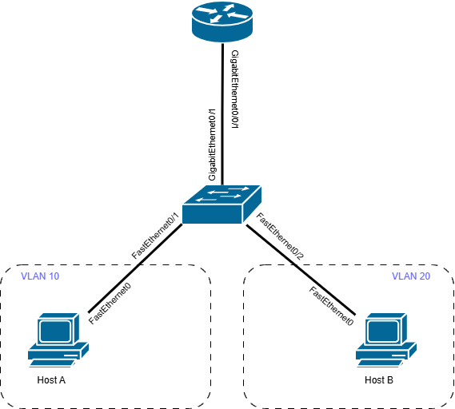
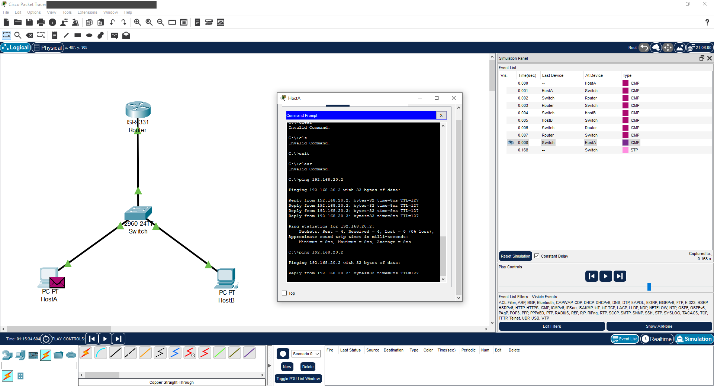

# Cisco Packet Tracer: VLAN and Router-on-a-Stick
 
Configuring a network topology (1 router + 1 switch + 2 PCs) with inter-VLAN routing

## Network Topology

## Test Results
Successful ping between Host A (VLAN 10) and Host B (VLAN 20):

## Self-Check Questions
1. **Why "Router-on-a-stick"?** A single physical cable (Trunk link) is used between the switch and the router, which is logically divided into subinterfaces to save physical ports.
2. **What is NAT used for?** It is used to translate private ("local") IP addresses of a local network into public ("global") addresses to allow Internet access.
