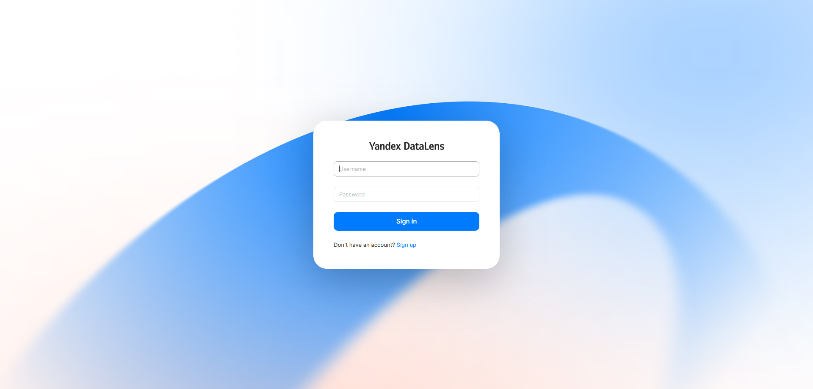
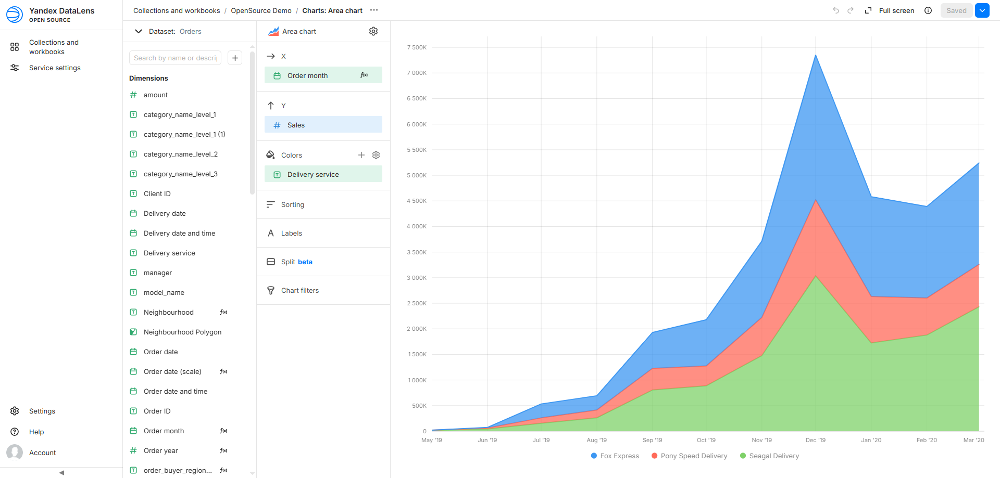

# DataLens Stand on RED OS 8

## Overview

A test stand demonstrating PostgreSQL + Yandex DataLens Open Source on a virtual machine running RED OS 8.0.3.

Deployment instructions - [Instructions](Instructions.md)

### Components

| Component | Role |
|---|---|
| RED OS 8.0.3 (VMware) | Host OS |
| Docker + Docker Compose | Containerization |
| PostgreSQL 16 (Docker) | External database with demo data |
| DataLens Open Source (Docker) | BI platform |
| nginx (host) | Reverse proxy + TLS |
| dnsmasq | Local DNS |

### Access

- **URL:** `https://datalens.internal`
- **Login:** `<admin-user>`
- **Password:** `<admin-password>`
- **Direct access (from the internal network):** `https://<vm-ip>`
- **For `datalens.internal` to resolve:** add `<vm-ip>` to the DNS server list (preferably first)
- **DB Connection:**
  1) Create Workbook
  2) Create Connection inside that Workbook
  3) Choose PostgreSQL
  4) Hostname: `host.docker.internal`; Path to Database: `demo`; Username: `postgres`; Password: `<db-password>` 

#### Demonstration

DataLens Login Page:


Demo chart:



### Architecture

```
Client (browser)
    │ HTTPS (443)
    ▼
nginx (host) ──proxy_pass──► DataLens (127.0.0.1:8080)
                                  │
                                  ▼
                            PostgreSQL (demo, 5432)
```

---

## Configuration Notes

The `docker-compose.production.yaml` in this repository was **generated by `init.sh`** and then **modified manually**:

1. Added `restart: unless-stopped` to every service — so containers start automatically after VM reboot.
2. Added `extra_hosts` block to every service — so `host.docker.internal` resolves inside containers.

The final docker-compose files:

1. DataLens: [DataLens Docker Compose File](docker-compose/datalens.yaml)
2. PostgreSQL: [PostgreSQL Docker Compose File](docker-compose/postgres.yaml)

---

## Issues and Solutions

### 1. No regular user created during RED OS installation
**Context:** During RED OS 8 installation, only the `root` account was created — no regular user.
**Solution:** Connected via SSH as `root` and created a user with `useradd`.

### 2. DNS not configured on RED OS
**Context:** After installation, the VM could not resolve external hostnames.
**Solution:** Used `resolvectl <interface> <dns>` to set DNS servers.

### 3. Docker and PostgreSQL setup
**Context:** Needed a database for the test stand.
**Solution:** Installed Docker, brought up PostgreSQL via `docker-compose.yml`.

### 4. Demo database import
**Context:** Needed realistic data for demonstration.
**Solution:** Imported the demo database "Airlines" from Postgres Professional.

### 5. Out of disk space
**Context:** Ran out of space while downloading DataLens.
**Solution:** Expanded the virtual disk by +20 GB in VMware.

### 6. Temporal error when starting DataLens
**Context:** While configuring and running the DataLens container, an error related to the `temporal` service appeared.
**Solution:** Tried to disable it via `--disable-temporal` per the DataLens README — did not work. Resolved after regenerating the configuration with `init.sh`.

### 7. DataLens authentication not working
**Context:** The `datalens-auth` container was up and healthy, but login failed with `Incorrect password`.
**Solution:** Temporarily disabled auth via `init.sh --disable-auth --up`, later restored by removing volumes (`down -v`) and restarting (`up -d`).

### 8. Insufficient VM resources
**Context:** The VM had only 2 GB RAM and 1 CPU core — the DataLens admin panel was heavily lagging.
**Solution:** Increased CPU to 2 cores.

### 9. `host.docker.internal` not resolving
**Context:** DataLens could not resolve `host.docker.internal`, even though the mapping was added to `docker-compose.production.yaml`.
**Solution:** Temporarily used the VM's static IP as a workaround.

### 10. VM could not render graphs on the demo database
**Context:** The VM could not handle graphs on the "Airlines" demo database with 2 CPU cores.
**Solution:** Dumped the DataLens demo database and restored it in a separate PostgreSQL container, so DataLens works with an external database. The DataLens demo database is light enough for the VM.

### 11. Final fix for `host.docker.internal`
**Context:** The mapping worked only for some services because `extra_hosts` was added to only one service.
**Solution:** Added the `extra_hosts` block to **every service** in `docker-compose.production.yaml`. Now DataLens connects to the database via `host.docker.internal`.

### 12. dnsmasq not resolving queries from outside
**Context:** The DNS record in dnsmasq (on the RED OS VM) resolved queries on the VM itself but not on the Windows host.
**Solution:** The exact cause was not identified, but the issue was resolved — `nslookup datalens.internal` now works on the host.

### 13. Self-signed certificate
**Context:** No public domain name available for TLS.
**Solution:** Created a self-signed certificate:
```bash
sudo openssl req -x509 -nodes -days 365 -newkey rsa:2048 \
  -keyout /etc/nginx/ssl/datalens.key \
  -out /etc/nginx/ssl/datalens.crt \
  -subj "/CN=datalens.internal"
```

### 14. SELinux blocking nginx → DataLens
**Context:** nginx returned `502 Bad Gateway` with `Permission denied` in logs when connecting to `127.0.0.1:8080`.
**Solution:** Allowed nginx to make network connections:
```bash
sudo setsebool -P httpd_can_network_connect 1
```

---

## Result

The stand is fully functional:

- DataLens is accessible via HTTPS through nginx.
- Connection to the external PostgreSQL works.
- Authentication is enabled. Although it is DataLens Auth.
