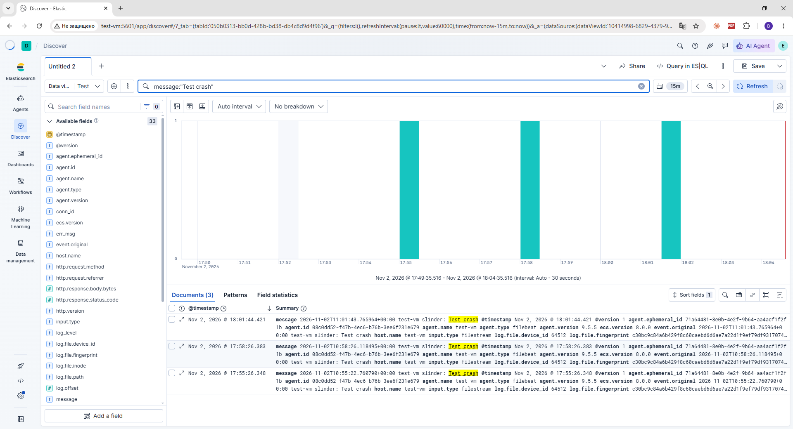
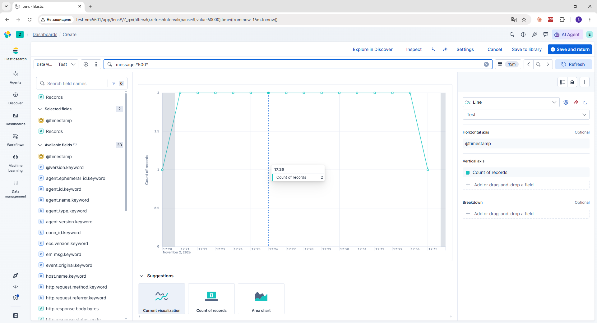
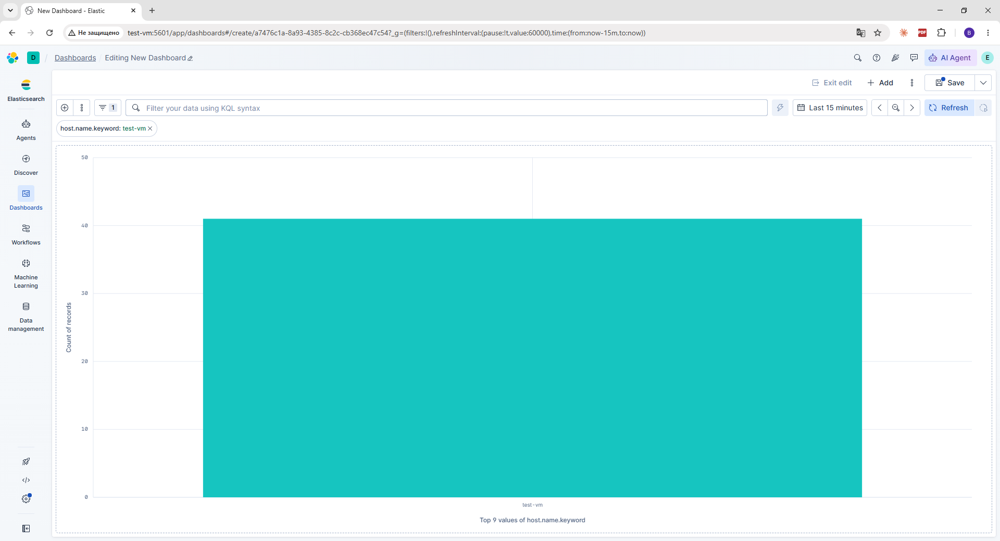

# Elasticsearch local development quickstart

```sh {"name":"ElasticSearch & Kibana Start script"}
curl -fsSL https://elastic.co/start-local | sh
```

In case if server responds with error, try to download the script from [GitHub](https://github.com/elastic/start-local/blob/main/start-local.sh), then run it with:

```sh
chmod +x start-local.sh && ./start-local.sh
```

The Elasticsearch + Kibana compose file generated by the script is saved for reference in [configs/docker-compose.yml](configs/docker-compose.yml).

## Logstash

Logstash receives logs from Filebeat on port `5044`, parses them (grok) and writes them to Elasticsearch into `logstash-*` indices. The container joins the already existing docker network `elastic-start-local_default`.

### 1. Pipeline configuration

```sh {"cwd":"./elastic-start-local","name":"Logstash pipeline config"}
mkdir -p logstash/pipeline
cat > logstash/pipeline/logs.conf <<'EOF'
input { beats { port => 5044 } }

filter {
  if [log][file][path] =~ /nginx\/error/ {
    grok {
      match => { "message" => "%{YEAR}/%{MONTHNUM}/%{MONTHDAY} %{TIME:ts} \[%{LOGLEVEL:log_level}\] %{POSINT:pid}#%{NUMBER:tid}: (\*%{NUMBER:conn_id} )?%{GREEDYDATA:err_msg}" }
    }
  } else if [log][file][path] =~ /nginx\/access/ {
    grok { match => { "message" => "%{COMBINEDAPACHELOG}" } }
  }
}

output {
  elasticsearch {
    hosts => ["http://es-local-dev:9200"]
    user => "elastic"
    password => "${ES_LOCAL_PASSWORD}"
    index => "logstash-%{+YYYY.MM.dd}"
    data_stream => "false"
  }
}
EOF
```

### 2. Docker Compose for Logstash

The JVM memory limit is lowered (`-Xmx512m`) because the host has little free RAM.

```sh {"cwd":"./elastic-start-local","name":"Logstash compose file"}
cat > docker-compose.logstash.yml <<'EOF'
services:
  logstash:
    image: docker.elastic.co/logstash/logstash:${ES_LOCAL_VERSION}
    container_name: logstash-local-dev
    environment:
      - LS_JAVA_OPTS=-Xms256m -Xmx512m
      - ES_LOCAL_PASSWORD=${ES_LOCAL_PASSWORD}
    volumes:
      - ./logstash/pipeline:/usr/share/logstash/pipeline:ro
    ports:
      - 5044:5044
    networks:
      - elastic-start-local_default

networks:
  elastic-start-local_default:
    external: true
EOF
```

### 3. Start and verify

```sh {"cwd":"./elastic-start-local","name":"Logstash start"}
docker compose -f docker-compose.logstash.yml up -d
docker logs --tail 20 logstash-local-dev
```

The logs should contain the lines `Pipeline started` and `Starting server on port: 5044`.

### 4. Filebeat

Filebeat is installed on the host (there is no separate VM) and ships logs to Logstash.

```sh {"name":"Filebeat install"}
curl -fsSL https://artifacts.elastic.co/GPG-KEY-elasticsearch | sudo gpg --dearmor -o /usr/share/keyrings/elastic.gpg
echo "deb [signed-by=/usr/share/keyrings/elastic.gpg] https://artifacts.elastic.co/packages/9.x/apt stable main" | sudo tee /etc/apt/sources.list.d/elastic-9.x.list
sudo apt update && sudo apt install -y filebeat
```

Do not point Filebeat at `/var/log/*` as a whole: it would pick up `.gz` archives and directories.

```sh {"name":"Filebeat config"}
sudo tee /etc/filebeat/filebeat.yml >/dev/null <<'EOF'
filebeat.inputs:
  - type: filestream
    id: varlog
    paths:
      - /var/log/syslog
      - /var/log/auth.log
      - /var/log/nginx/*.log
output.logstash:
  hosts: ["localhost:5044"]
EOF
sudo systemctl enable --now filebeat
sudo filebeat test output
```

The same config is available in [configs/Filebeat.yml](configs/Filebeat.yml).

### 5. Test error and index check

```sh {"name":"Simulate error"}
logger -p user.err "Test crash"
```

```sh {"cwd":"./elastic-start-local","name":"Check logstash-* index"}
. ./.env
sleep 10
curl -s -u "elastic:$ES_LOCAL_PASSWORD" "localhost:9200/_cat/indices/logstash-*?v"
```

### 6. Kibana

1. Stack Management → Data Views → create `logstash-*` with time field `@timestamp`.
2. Discover: select the `logstash-*` data view, period — Last 15 minutes. The test error from `logger` can be found with the query `message:"Test crash"`; a general error search is `message:*error* or message:*ERROR* or log_level:error or response:500`. Filter by `host.name` and time. The `log_level` field exists only for nginx error events and is absent in syslog, so the test error cannot be found by it.

   

3. Dashboard (Lens): _Error rate_ — count of documents with `log_level: error` over time; _Top hosts_ — top values of the `host.name` field.

   

   
