# Observability: Deploy and configure Zabbix, Prometheus+Grafana

This project covers the deployment of Observability instruments: Zabbix server and Prometheus+Grafana stack, configuring Grafana Alerts

---

## Host Machine

Host machine for this project is a virtual machine running on Ubuntu Server in VMWare Workstation

```
Hostname: test-vm
IP-address: <vm-ip> (static)
```

## Zabbix Server

Zabbix Server was deployed by following the official [Docker deployment guideline](https://github.com/zabbix/zabbix-docker). It makes use of the tool `Make`

I ran `make up DB=pgsql OS=alpine ZABBIX_WEB_NGINX_HTTP_PORT=8282 ZABBIX_WEB_NGINX_HTTPS_PORT=8443` in order to deploy Zabbix+PostgreSQL+Nginx. Now, you can access the Zabbix Server web-panel `http://<vm-ip>:8282`

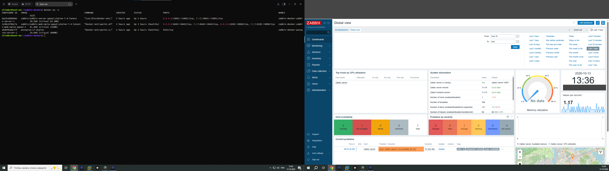

In order to test the Zabbix server & agent interaction, I downloaded [Zabbix Agent msi-file](https://www.zabbix.com/download_agents) on my workstation (`<workstation>`)

## Configuring Rocket.Chat Alert for Zabbix

1. Enable Rocket.Chat as a `Media type` in Zabix server `Alerts` tab to be able to utilize its incoming webhook
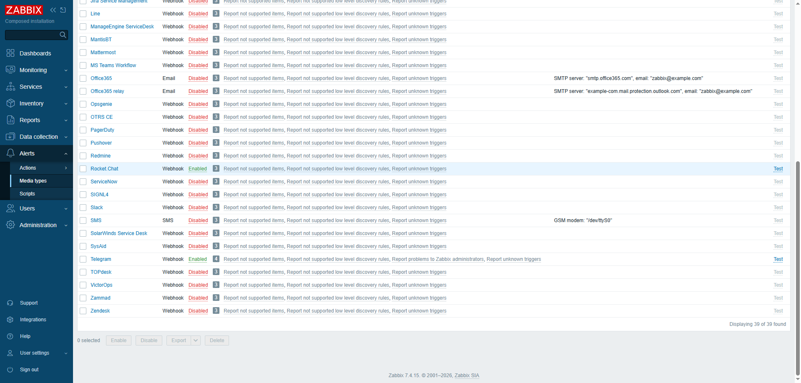
2. Configure `Rocket.Chat` Media Type by entering the URL of the Rocket.Chat server (`https://<rocketchat-host>`) in `rc_url`, creating token in Rocket.Chat and entering it in `rc_user_token`. Also, Media Type configuration needs `rc_user_id`
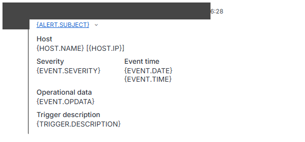


## Prometheus & Grafana

Prometheus & Grafana deployment is done using Docker Compose. The compose file can be found here: [docker-compose.yml for Prometheus & Grafana ](configs/prometheus-grafana-docker-compose.yml)

Containers sit in the same docker network `observability`.

For security reasons, I am planning to not expose `prometheus` container port `9090`, so that only `grafana` has access to it

Notice, that in compose-file there's also a container named `node-exporter` - it collects metrics from its host machine (logically, its container). But I configured it to collect host machine (`test-vm`) instead

Running Prometheus instance (port 9090):
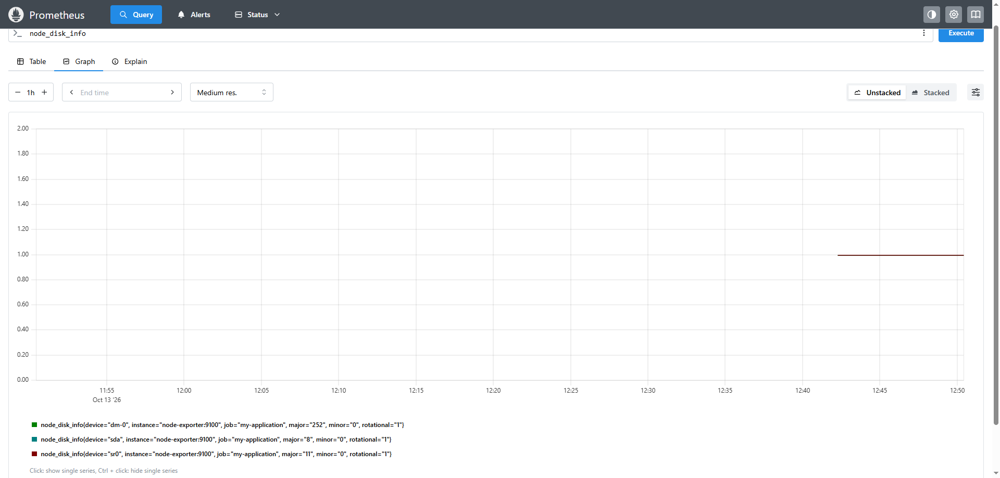

In order to connect Prometheus as a Data Source for Grafana, one needs to create a `Connection` in Grafana web-panel (port 3000). Prometheus URL: http://prometheus:9090 (one of the benefits of using one docker network for `prometheus` and `grafana` containers is in our ability to use their names in URLs)

Demo graph - Data Source is Prometheus here: 
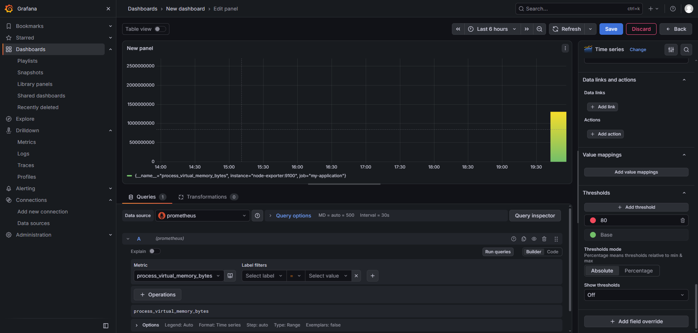

## Alerts in Grafana

To test the Email Alerts in Grafana, I created a `Contact point` and pointed it to the corporate SMTP server (`<smtp-host>:25`)

Test alert sent to my email (`<user>@<company-domain>`):
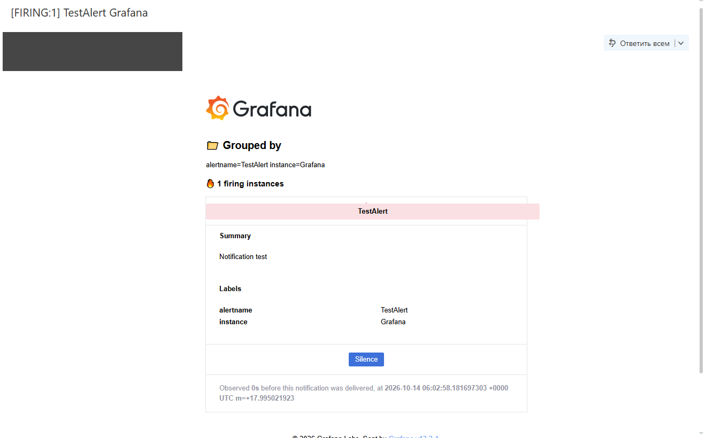

In order to configure Alerts to be sent to mail, I mounted the file [grafana.ini](configs/grafana.ini) in compose-file ("./grafana.ini:/etc/grafana/grafana.ini"). In `grafana.ini` file I made some changes in order to enable Alerts:
```
[smtp]
enabled = true
host = <smtp-host>:25
user = <user>@<company-domain>
# If the password contains # or ; you have to wrap it with triple quotes. Ex """#password;"""
password = "*****"
;cert_file =
;key_file =
;skip_verify = true
from_address = <user>@<company-domain>
from_name = Grafana Alerts
# EHLO identity in SMTP dialog (defaults to instance_name)
;ehlo_identity = dashboard.example.com
# SMTP startTLS policy (defaults to 'OpportunisticStartTLS')
;startTLS_policy = NoStartTLS
# Enable trace propagation in e-mail headers, using the 'traceparent', 'tracestate' and (optionally) 'baggage' fields (defaults to false)
;enable_tracing = false
```

Then, restart `grafana` container: `docker compose restart grafana`

SMTP Configuration for Alerts
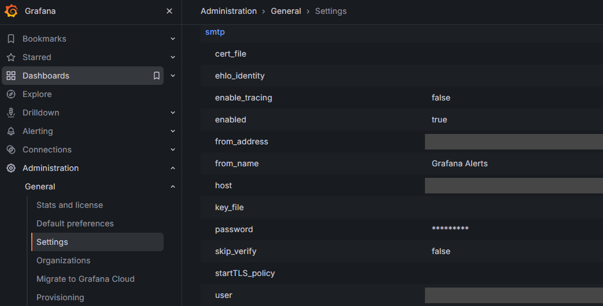

Now Grafana can send us emails! Here's the configuration of the alert which fires if CPU usage of the process `node-exporter` is >80%. Data Source is Prometheus:
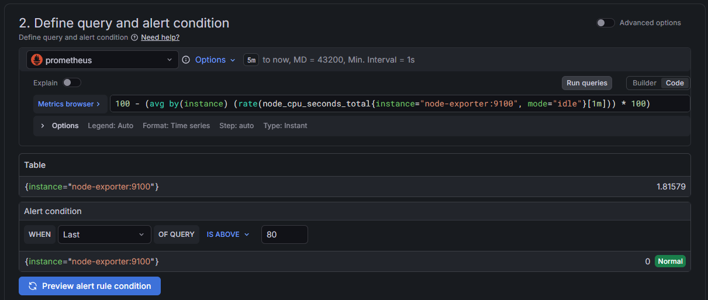

To test the created alert I lowered the CPU Usage threshold to 2%. Here's the alert email from Grafana
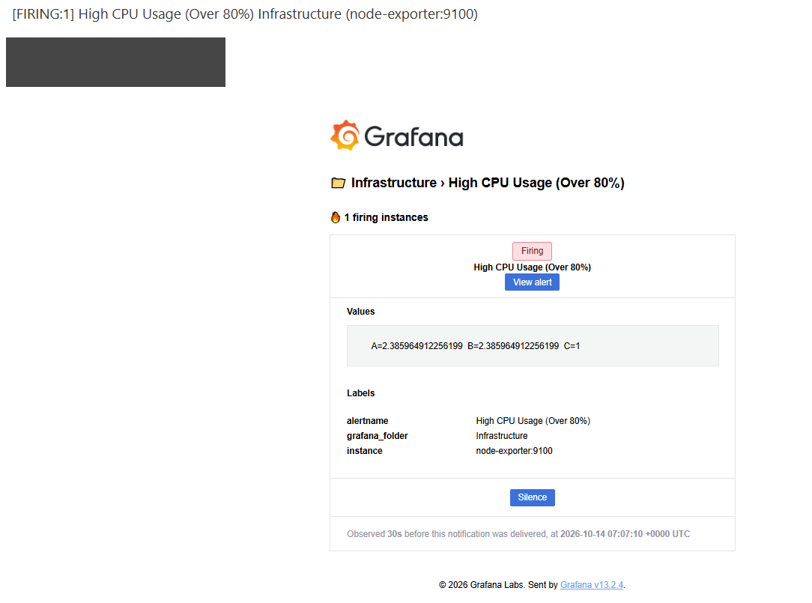

## Creating Dashboards in Grafana

In order to create dashboards in Grafana that will retrieve the data from Zabbix, you need to install its Plugin. After that, we can utilize default dasboards provided by plugin. Zabbix URL: `http://<vm-ip>:8282/api_jsonrpc.php` (`zabbix` container is not in the same network, so we need to explicitly specify the ip-address)

Zabbix Dashboard in Grafana that showcases workstation data (retrieved by Zabbix Server through Zabbix Agent installed on my workstation):
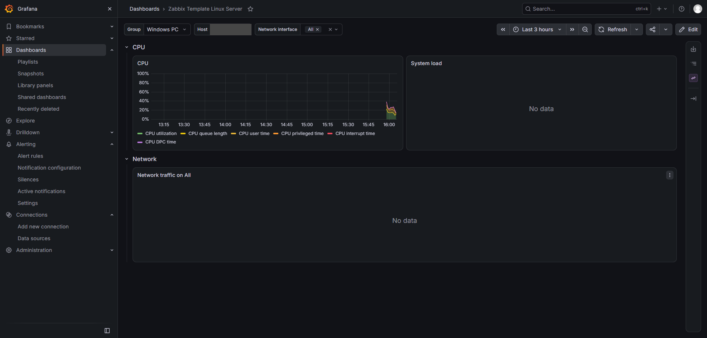

Here is the Dashboard I made with 3 panels on it that show `node-exporter` process' resources utilization:
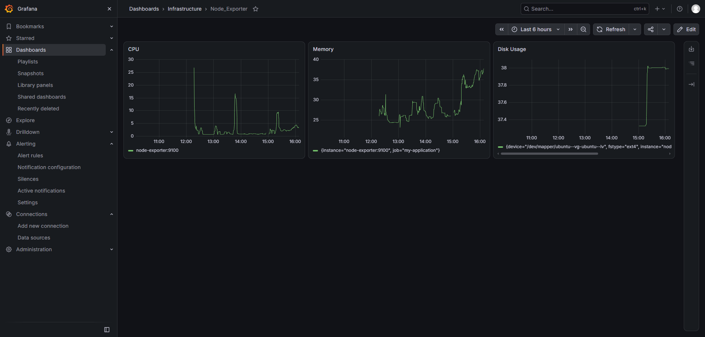

