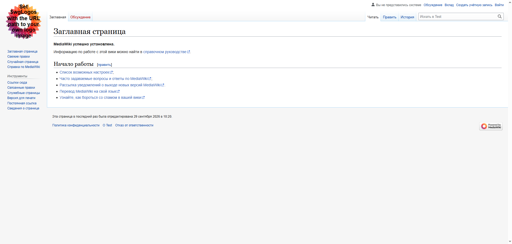

# MediaWiki Deployment on Rocky Linux 8

This project covers the manual deployment of **MediaWiki 1.39.3** on a **Rocky Linux 8.10** virtual machine using a custom **LVM** layout and a **Nginx**, **PostgreSQL**, and **PHP 7.4** stack.

---

## Infrastructure Overview
* **OS:** Rocky Linux 8.10
* **Resources:** 2 vCPUs, 4 GB RAM, 30 GB Storage (LVM Manual Partitioning)
* **Networking:** Hostname `vm-test1`, DHCP IPv4 enabled, IPv6 disabled
* **Security:** `root` disabled, administrative user `tadmin` created, custom SELinux contexts enforced

---

## Demonstration

Mediawiki main page opened at `http://<vm-ip>` (vm-test1 IP address):


---

## Troubleshooting

During the deployment, several hidden configuration conflicts and environmental issues arose. Below are the key problems encountered and how they were resolved:

### 1. `dnf install php` Dependency Trap (Apache Override)
* **Problem:** Running a standard `dnf install php` implicitly pulls down the **Apache (`httpd`)** web server as a hard dependency. This violates the Nginx requirement and leads to port conflicts on port 80.
* **Solution:** Explicitly excluded the raw `php` meta-package. Installed **`php-fpm`** alongside individual specific extensions required for MediaWiki:
  ```bash
  sudo dnf install php-fpm php-cli php-common php-pgsql php-mbstring php-xml php-intl php-gd
  ```

### 2. MediaWiki Version & PHP Stream Mismatch
* **Problem:** Accidentally pulling down the latest stable MediaWiki archive (v1.43) caused an instant fatal block because newer branches require PHP 8.1+. The project spec locked the environment to PHP 7.4.
* **Solution:** Re-synced the native DNF appstream module back to `php:7.4`, wiped the site directory, and pinned the archive strictly to the LTS release requested in the specification.

### 3. FPM Session Permissions (`Permission Denied 13`)
* **Problem:** After toggling PHP versions, the directory allocated for handling user PHP sessions (`/var/lib/php/session/`) automatically reverted ownership back to the `apache` system user. This completely broke the MediaWiki web installation wizard when generating tokens.
* **Solution:** Handed full recursive path ownership down to the Nginx process:
  ```bash
  sudo chown -R nginx:nginx /var/lib/php/session/
  ```

### 5. PostgreSQL `Ident Authentication Failed`
* **Problem:** By default on RHEL systems, PostgreSQL relies on `ident` map checking for local connections, requiring the operating system user mapping to exactly match the database role name (`nginx` vs `wikiuser`).
* **Solution:** Converted standard loopback IPv4/IPv6 verification models in `/var/lib/pgsql/data/pg_hba.conf` from `ident` over to strict credential verification (`md5` / `scram-sha-256`), then forced a daemon reload:
  ```text
  host    all             all             127.0.0.1/32            md5
  ```

---

## 📂 Site Architecture
Conforming directly to the explicit path layouts outlined in the project requirements:
* **Web Root:** `/var/www/wiki/www`
* **Server Logging:** `/var/www/wiki/log/access.log` & `/var/www/wiki/log/error.log`
