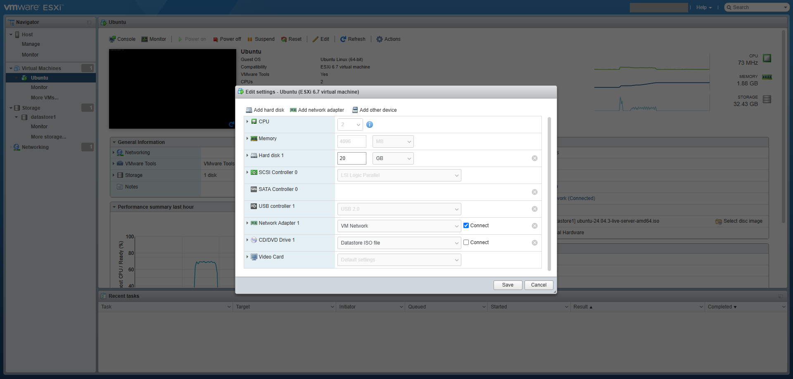
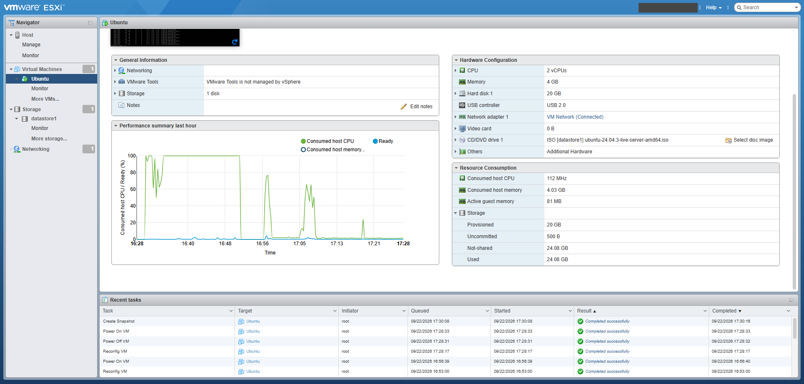
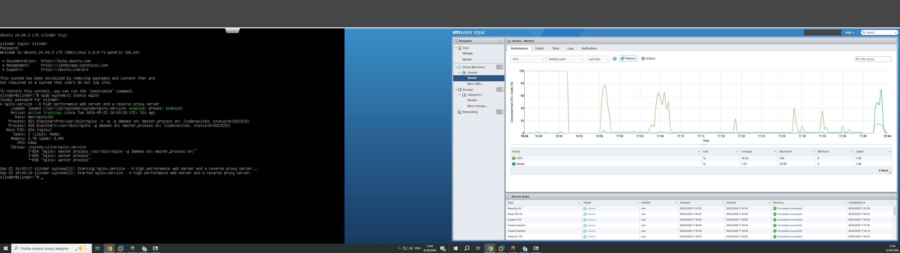

# Lab Work: Create and Manage VM in VMware ESXi

## Objective
Create a Linux virtual machine in VMware ESXi, install a web server, make snapshots, and set resource limits.

## What was done

1. **Created a Virtual Machine**
   * Installed VMware ESXi.
   * Created a VM named `Ubuntu` (2 CPU, 4 GB RAM, 20 GB Disk).
   * Installed Ubuntu Server.

2. **Installed Nginx and Made Snapshots**
   * Made a first snapshot named `Ubuntu Clean` right after installing the OS.
   * Installed the Nginx web server.
   * Checked that Nginx is running successfully.
   * Made a second snapshot named `After Nginx Installation`.

3. **Set Resource Limits**
   * Opened the performance monitor to see CPU and RAM usage.
   * Turned off the VM.
   * Opened settings to put a limit on CPU and Memory usage.

---

## Screenshots

### System settings

Shows the "Edit settings" window where we can see the Ubuntu VM configuration. This is where we change the VM settings to add strict limits for CPU and Memory.

### Monitoring. Resource Usage restrictions: unlimited

Shows how much resources the VM is using right now with Nginx service running. Configuration: 4GB RAM, 2CPU, 3000MHz.

### Monitoring. Resource Usage restrictions: 2GB RAM, 1CPU, 1000MHz

Shows the Nginx service running on the left screen and monitoring resources on the right screen. Configuration restricted to: 2GB RAM, 1CPU, 1000MHz

### Snapshots

Shows the Snapshot Manager window. We have two snapshots in the right order: `Ubuntu Clean` and then `After Nginx Installation`.
